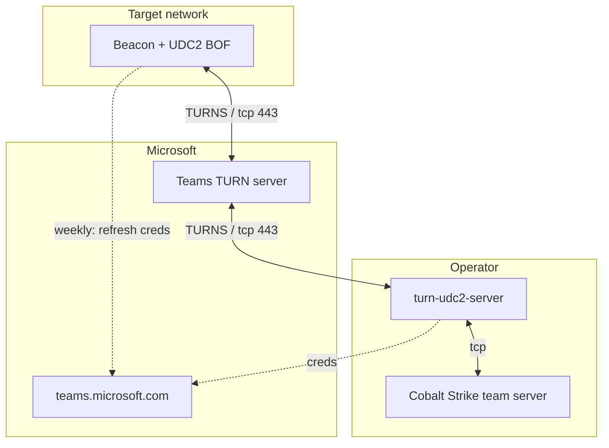

# TURN UDC2

A [Cobalt Strike 4.12+ User-Defined C2 (UDC2)](https://hstechdocs.helpsystems.com/manuals/cobaltstrike/current/userguide/content/topics/listener-infrastructure_user-defined-c2.htm) implementation that tunnels **all** Beacon traffic through Microsoft Teams TURN relay infrastructure.

The Beacon payload speaks raw TURN (RFC 5766) over TLS on TCP 443 to a Microsoft Teams TURN server, authenticating with anonymous visitor credentials — exactly like a Teams web client behind a restrictive firewall. From the target's network, the implant makes **one TLS connection to one Microsoft IP on port 443** and, shortly before its ~7-day TURN credentials expire, two short-lived HTTPS connections to `teams.microsoft.com` to fetch fresh ones: no operator infrastructure is ever directly visible.

Inspired by and borrowing the Teams credential acquisition flow from [praetorian-inc/turnt](https://github.com/praetorian-inc/turnt), which tunnels WebRTC data channels over TURN for interactive tooling. This project replaces the manual WebRTC offer/answer with a permission-based rendezvous so that the channel works fully autonomously inside Beacon.



## Table of contents

- [Quick start](#quick-start)
- [Operational notes](#operational-notes)
- [The offer/answer problem, solved without a side channel](#the-offeranswer-problem-solved-without-a-side-channel)
- [Protocol (BOF ↔ UDC2 server, inside TURN DATA)](#protocol-bof--udc2-server-inside-turn-data)
- [IOCs](#iocs)
- [Testing](#testing)
- [Repository layout](#repository-layout)
- [Limitations / future work](#limitations--future-work)
- [Credits](#credits)

## Quick start

Prerequisites: Go 1.24+, mingw-w64, Cobalt Strike 4.12+.

1. Build the Go tooling:

   ```sh
   go build -o bin/ ./cmd/...
   ```

2. Start the UDC2 server; it fetches anonymous Teams TURN credentials, allocates a relay, and prints/bakes the BOF configuration. `--ts-port` must match the listener for the arch you build (x64: 2222, x86: 2223):

   ```sh
   ./bin/turn-udc2-server \
       --ts-addr 127.0.0.1 --ts-port 2222 \
       --emit-bof-config bof/bof_config.h
   ```

3. Build the BOF with the emitted config:

   ```sh
   make -C bof     # → turn_udc2.x64.o, turn_udc2.x86.o (~22 KB each)
   ```

4. Within Cobalt Strike, load `turn-udc2.cna`, then start the listeners via the menu: **TURN UDC2 > Start TURN UDC2 Listeners**.

5. Run the payload on a target → the session checks in over Teams TURN.

The UDC2 server can run anywhere that can reach both the internet (TCP 443) and the team server.

## Operational notes

- **Keep `turn-udc2-server` running.** Its relayed address is baked into payloads; a restart allocates a new address and requires regenerating payloads (like rotating a C2 domain). Run it under a tmux/screen session or systemd/launchd.
- **Pin the TURN server IP.** `turn-udc2-server` records the TURN server IP it landed on in the emitted `bof_config.h` (`TURN_SERVER_ADDR`), so the BOF connects to the *same* TURN server regardless of the target's geo-DNS view. Without pinning, the operator and the Beacon can end up on different TURN servers with disjoint relay pools — and the permission-based rendezvous breaks. The emitted config does this automatically.
- **Relay pool discovery.** Teams TURN servers hand out relayed addresses from a multi-IP pool (a few /24s per server). The server probes the pool at startup (`-probe`, default 8 throwaway allocations) and installs permissions for the observed /24s so first-contact packets from new Beacons are delivered. Widen with `--permit-cidr` (keep them /24-or-smaller) if check-ins time out.
- **x86 and x64** are both supported (UDC2 listeners are x86/x64 only per the docs). They use separate team server ports (default 2222/2223): the relay forwards to a single port, so run one `turn-udc2-server` per arch, relaying to that arch's listener and building that arch's BOF from its emitted `bof_config.h`.

## The offer/answer problem, solved without a side channel

Two TURN clients can only exchange data after each side (a) knows the other's **relayed address** and (b) has installed a **permission** for the other's relay IP. TURN itself has no rendezvous mechanism — this is what WebRTC solves with SDP (Session Description Protocol) offer/answer over a signaling channel (turnt does it with manual copy/paste).

This project eliminates the need for a side channel entirely:

1. **The "offer" is static configuration.** The UDC2 server's relayed address is baked into the BOF at payload-generation time — exactly like a C2 domain in a classic profile. The server pins the same TURN server (`--turn-server-ip`) so both allocations come from the same relay pool.
2. **The "answer" is learned over TURN.** The BOF's first Send indication reaches the server's relay from the BOF's relay address; the server learns that address from the source of the packet and replies to it. No signaling traffic ever leaves the TURN path.
3. **Permissions cover the rendezvous.** The BOF installs a permission for the server's relay IP. The server keeps permissions for the relay pool (its own relay IP by default, a /24 with `--permit-self-24`, or explicit `--permit-cidr` ranges) so that first-contact packets from unknown Beacons are delivered rather than silently dropped. TURN permissions are per-IP, so one permission covers every port on that address.

## Protocol (BOF ↔ UDC2 server, inside TURN DATA)

```
[session_id:4 BE][type:1][msg_seq:1][frag_index:2 BE][frag_total:2 BE][length:2 BE][payload]

session_id  random per-Beacon identifier; stable across BOF re-allocations
type        1 = DATA (fragment), 2 = RESEND request
msg_seq     per-message counter; a new value restarts receiver state
frag_*      fragmentation of one Beacon frame
payload     DATA: fragment bytes (of | 4-byte LE length | frame data |)
            RESEND: u16 count + count fragment indices to retransmit
```

The whole message rides in TURN Send/Data indications (or ChannelData once the server's pion client binds a channel — the BOF parses both). Frames larger than the chunk size (default **1200 bytes**) are split and reassembled.

Two properties of the relayed path drive the design:

- **The relayed hop is lossy UDP.** TURN-over-TLS-over-TCP is reliable on the client↔server legs, but RFC 5766 relays peer traffic as plain UDP datagrams — Microsoft's relay dropped ~0.4% of fragments in testing. Both directions therefore implement a simple ARQ: a receiver tracks gaps per message sequence and RESENDs missing fragments after a 600 ms stall.
- **Fragment size must stay small.** Chunks of 4096 bytes IP-fragment the relayed datagram and get dropped (and the TURN server eventually kills the connection); 1200 bytes arrive intact. The default is 1200 on both sides.

## IOCs

One outbound TCP 443 connection to a Microsoft IP (SNI `worldaz-msit.relay.teams.microsoft.com`), TLS via Schannel with automatic certificate validation, speaking STUN/TURN inside. Around once per week the BOF additionally makes two short-lived HTTPS connections to `teams.microsoft.com` (the anonymous visitor credential flow, same domain family as the TURN connection). No other destinations are contacted.

## Testing

```bash
go test ./...                 # unit + full in-process e2e (pion TURN server over TLS,
                              # fake team server, BOF-equivalent client)

# Live validation against real Microsoft infrastructure:
./bin/turn-probe                       # fetch + display Teams TURN credentials
./bin/turn-probe -allocate 5           # observe the relay pool of a TURN server
./bin/turn-probe -hairpin              # relay-to-relay exchange between two allocations
./bin/turn-probe -blast -blast-count 74 -blast-size 1200   # burst/size behavior

# Full dress rehearsal without Cobalt Strike:
./bin/turn-udc2-fakets --bind-port 2222 &
./bin/turn-udc2-server --ts-port 2222 --emit-bof-config bof/bof_config.h &
# ...wait for "waiting for Beacons", then read the relay + pinned IP from
# bof/bof_config.h and simulate a full check-in:
./bin/turn-probe -simulate-beacon <relay_ip:port> -turn-server-ip <pinned_ip> \
    -frame-size 300000
# → "round trip OK: 300004 bytes" (measured 355 ms through Teams TURN)

# Testing the actual BOF object code on Windows (outside Beacon):
make -C bof debug                  # → bof/turn_udc2_test.exe
# copy it to a Windows x64 box and run while the server + fakets are up;
# it performs one proxy exchange and verifies the echo.
```

## Repository layout

| Path | What it is |
| --- | --- |
| `cmd/turn-udc2-server` | Operator-side relay: TURN client + session muxing + team server relay |
| `cmd/turn-udc2-fakets` | Fake team server for testing without Cobalt Strike (echoes frames) |
| `cmd/turn-probe` | Live validation: credential fetch, relay pool discovery, relay-to-relay test, full BOF simulation |
| `internal/msteams` | Anonymous Teams TURN credential acquisition (visitor flow) |
| `internal/turnc` | TURNS dialer (HTTPS_PROXY-aware) + pion/TURN client wrapper + raw credential-rotating STUN transactions |
| `internal/proto` | Chunk framing shared by the Go side and (spec-wise) the BOF |
| `internal/udc2` | The server: relay, permissions, sessions, team server I/O |
| `bof/` | The UDC2 BOF: Schannel TLS + STUN/TURN + framing in C, no CRT |
| `bof/debug/` + `make -C bof debug` | `turn_udc2_test.exe`: runs the exact BOF objects outside Beacon for testing |
| `turn-udc2.cna` | Aggressor script to create the UDC2 listeners |

## Limitations / future work

- Frames are chunked at 1200 bytes; `tasks_max_size` larger than the default 1 MiB requires matching `TURN_MAX_FRAME` (BOF) and server-side adjustment.
- Tested against the Teams TURN endpoints at time of writing; Microsoft can change their infrastructure at any time (as they did for Zoom after TURNt's release).

## Credits

- [praetorian-inc/turnt](https://github.com/praetorian-inc/turnt) — Teams TURN credential acquisition, and the inspiration for TURN-based C2.
- [pion/turn](https://github.com/pion/turn) — TURN client/server used by the Go side.
- [Cobalt-Strike/udc2-vs](https://github.com/Cobalt-Strike/udc2-vs) — the official UDC2 BOF template.
